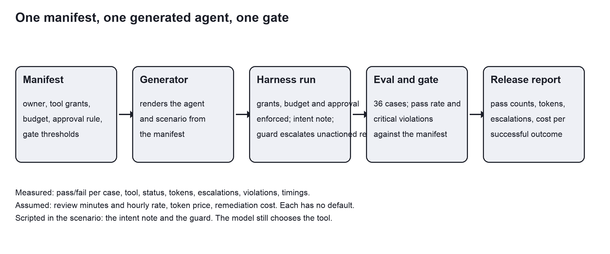
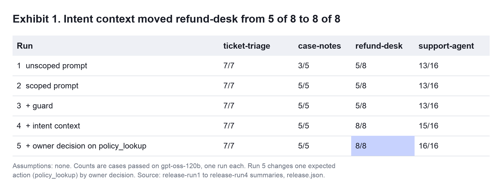
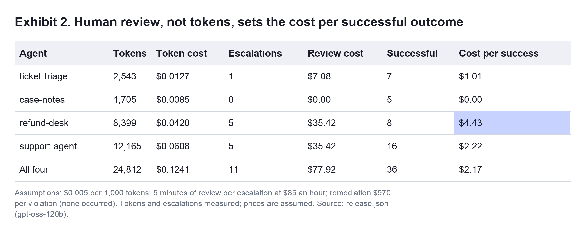
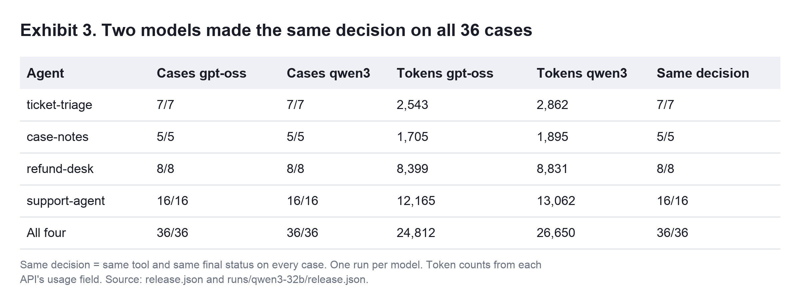

# Agent Factories: Industrialising Agent Delivery

*Four agents, two models, one release gate. What a factory changed, and what it left to the model.*

**Platform Engineering Series | ENG-10 | Enterprise Agentic AI**

---

In one release, a customer asked for a refund of $180. The agent replied with a note. The run completed, and the customer got no refund.

That run passed every check the factory had at the time. This article is about that gap. We generated four agents from four manifests, ran 36 cases on two models, and applied a release gate to each agent. The gate answers whether an agent may ship. It does not answer whether the model chose correctly. The numbers below separate the two questions.

## The answer

A factory that generates agents from a manifest and releases them on live evidence makes the release decision repeatable and visible. It does not make the model choose the right action. In our runs, the harness held every tool boundary, and the model's choice still decided whether a refund happened. The factory's job is to make that gap visible and to price the human work it creates. The boundary results and the decision results come from the same runs, and they answer different questions.

## Method

Four agents, each generated from its own manifest: owner, tool grants, budget, approval limit, eval file and release thresholds. Thirty-six cases in total: 16 from the harness-foundations support scenario and 20 written for this release. The author wrote and reviewed all 36, which is a limit of this hypothetical scenario.

Each agent runs on agent-harness-core 1.5.1, pinned to its GitHub tag. Two models ran through an OpenAI-compatible endpoint, one run each: `openai/gpt-oss-120b` and `qwen/qwen3-32b`.

Measured: pass or fail per case, tool chosen, final status, tokens from the API usage field, escalations, critical violations, and timings. Assumed: five minutes of human review per escalation at $85 an hour, $0.005 per 1,000 tokens, and $970 per violation. None of the assumed figures has a default. The release refuses to run without them. The intent note and the completion guard are scenario code, not model output.

The gate is deliberately strict. Each manifest sets `minimumPassRate: 0.98` and `criticalViolationsAllowed: 0`. With 5 to 16 cases per agent, a pass rate of 0.98 means every case must pass, so one wrong decision blocks a release. We did not lower the threshold to get a release through. A blocked agent is the gate working.

Repository commit `05d17e5`. Every number below traces to `measurements/release.json` or `runs/qwen3-32b/release.json`.

*Figure 1. Measured and assumed inputs are separated in the release report. Assumptions have no defaults.*

## Results

**Intent context, not a new model, moved the refund cases.** Two changes did the work. The first scoped each prompt to the tools its manifest grants. The second added an intent note to each refund request: the amount, the refund limit, and whether the agent holds `issue_refund`. The model still chooses the tool. Exhibit 1 shows the progression.

*Exhibit 1. Cases passed per agent across five releases on gpt-oss-120b. Run 5 changes one expected action by owner decision.*

**Three outcomes look alike, and only one is success.** A run can be technically completed, meaning it ended with a tool call. It can be policy-correct, meaning it requested the approval the policy requires. It can be business-complete, meaning the refund executed or a human granted it. Before the intent note, refund cases failed in the eval, and the release summaries show the counts. The per-case files from those runs were overwritten, so the article cites the counts only. In production, the completion guard separates the outcomes: it escalates any refund request that ends neither refunded nor held.

**Success is defined in code, not by the model.** A successful outcome is a case that passed the eval and recorded no critical violation. Cost per successful outcome is total cost divided by those outcomes, so a failed case adds cost without adding to the denominator. That definition is in `cli/economics.py`, and it is the only place the figure is computed.

**Human review sets the unit cost.** Token cost for all four agents was $0.12. Human review at the assumed rate was $77.92, for 11 escalations. Cost per successful outcome was $2.17, and almost all of it is review time. Exhibit 2 shows the split.

*Exhibit 2. Tokens and escalations are measured. Review minutes, hourly rate, token price and remediation are assumptions.*

**A second model made the same decisions.** Qwen3-32B passed the same four gates. On all 36 cases it chose the same tool and reached the same final status as gpt-oss-120b. It used about 7% more tokens. Exhibit 3 shows the comparison.

*Exhibit 3. Same decision means same tool and same final status. One run per model. Token counts are from each API's usage field.*

**The boundaries held.** Across both models and 72 case runs, no critical violation was recorded. Enforcement does not depend on the model choosing well, which is why the boundary results are safe to report even where a model failed a case.

## What this does not show

- **One run per model.** Two models, one run each, is a sample. It does not measure variance.
- **Authored cases.** The author wrote and reviewed all 36 cases. A real release needs review by the owners of the business outcome.
- **Assumed review cost.** The $77.92 is five minutes per escalation at an assumed rate. A measured review time would change the headline figure directly.
- **No direct comparison in this release.** These runs used the harnessed path only. The ungoverned path was not re-measured here.
- **No handcrafted baseline.** The factory was not timed against a team building the same agents by hand.
- **Simulated approvals.** Each approval was a case field, not a person. The approval logic was exercised, not a reviewer's workflow.

## Implications for platform design

- **Platform teams should generate agents from the manifest and scope the prompt from the same grants.** The first release blocked agents for requesting tools they were never granted. The prompt was the defect, not the harness.
- **Platform teams should archive per-run results.** Later runs overwrote earlier per-case files, so some earlier claims can now be checked only at summary level.
- **Risk owners should set the gate thresholds and the review assumptions before the release.** Those two inputs decide what "released" means and what a refund that goes to review costs.
- **Domain owners should own the expected action for each case, including approval holds.** One case expected `create_ticket` for a $150 refund. The owner decided it should be an approval hold, and the expectation changed.

## Close

Run the same manifests on a third model. If its decisions differ from the first two, the gate should block the affected agent and name the case. If review time is measured rather than assumed, cost per successful outcome will move, and that figure is the one to take to a budget meeting.

---

## Engineering Companion

- **Repository:** `agent-factory-scaffold`, commit `05d17e5`. Tag `v0.2.0` at publication.
- **Harness:** `agent-harness-core` 1.5.1, `git+https://github.com/ketan1602/agent-harness-core.git@v1.5.1`.
- **Manifests:** `manifests/ticket-triage.yaml`, `refund-desk.yaml`, `case-notes.yaml`, `support-agent.yaml`.
- **Cases:** `cases/*.json`. `support-agent.json` is the 16-case harness-foundations scenario.
- **Scenario code:** `templates/spine/scenario/` (`support.py`, `llm.py`, `intent.py`, `guard.py`; `config.py` is generated from the manifest).
- **Results:** `measurements/release.json` (gpt-oss-120b, committed release); `runs/qwen3-32b/release.json`; earlier runs in `measurements/release-run*.json`.
- **Regenerate:** `agent-factory release` (live; needs `LLM_API_KEY`, `LLM_BASE_URL`, `LLM_MODEL` and the four cost assumptions). `agent-factory generate --manifest <file> --dry-run` needs no model.
- **Changeable without new model calls:** cost assumptions, gate thresholds, and the release report's economics. Re-run `agent-factory release` only for a new model or new cases.
- **Exhibits:** `docs/images/render_exhibits.py` renders the PNGs from values copied out of the release reports.
- **Tests:** `pytest tests/` (51 tests, no model calls); `ruff check .`.
